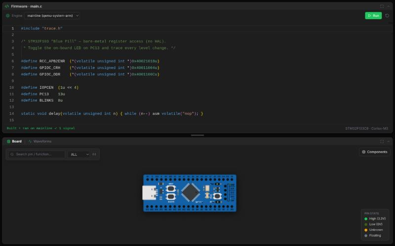
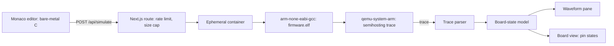
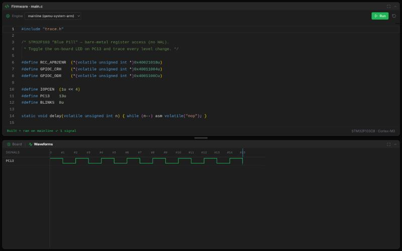

# mcusim

**A browser-based simulator for the STM32F103 "Blue Pill".** Write bare-metal C, press Run, and watch your register-level code drive a virtual board and its waveforms. The firmware really is cross-compiled and executed under QEMU. No toolchain install and no hardware needed.

Live demo: **https://stm.pontsho-mbizo.co.za**

<p align="center"></p>

*The default blink firmware after pressing Run: "Built + ran on mainline, 1 signal", with the 44-pin Blue Pill below.*

Companion to [fpgasim](https://github.com/PontshoMbizo/fpgasim), which does the same for the Tang Nano 9K FPGA with Verilog.

## How it works



- **Real firmware, no HAL.** You write register-level C (RCC, GPIO, TIM, NVIC). The F103 startup code, linker script and a small trace helper are provided, so the C you write is the machine code that runs.
- **Board model.** A self-contained SVG Blue Pill with 44 pins, alternate functions, an inspector, search and a legend. Pin ids are the GPIO names.
- **Sandbox.** Untrusted C from the internet runs in a throwaway container with no network, a read-only filesystem and a non-root user, with caps on memory, processes, runtime and output size.

<p align="center"></p>

*The same run in the Waveforms tab: PC13, the on-board LED pin, toggling once per blink of the default firmware.*

## Design choices

| Decision | Why |
|---|---|
| QEMU as the execution engine | Runs real ARM Cortex-M3 machine code instead of interpreting a toy language |
| Two engines spiked: mainline and xPack QEMU | Mainline QEMU has no STM32F103 machine (the closest is the STM32F100-based `stm32vldiscovery`) and does not reliably model GPIO output, so it reports pin events over semihosting. xPack models GPIO natively. The UI selector defaults to mainline |
| Trace shaped like VCD | The waveform pane and board model are shared with fpgasim |
| Hard limits at three layers: route, container flags, host timer | A runaway or hostile program fails fast and is reported as a timeout, not a hung server |

## Findings

Measured on the live demo, 6 November 2026. Timings are from a browser, so they include the network round trip.

| Area | Result |
|---|---|
| Full pipeline round trip (cross-compile, QEMU run, trace) | 357 to 469 ms over 4 runs of the 35-line default blink firmware |
| Board model | 44 pins |
| Unit tests | 68 pass in about 0.2 s, Node only (trace parser and chip model) |
| Sandbox limits | 15 s wall clock for compile and run, 256 MB memory, 128 processes, 8 MiB of trace output, 200 KiB of source |
| Request limits | 4 concurrent runs, 30 requests per minute per IP |

### Limits of these results

- The timing sample is small (4 runs of one program) and was taken from one location.
- Only GPIO output is observed so far, via the trace. SysTick, timers and PWM, and USART are not yet modelled.
- Which engine becomes the default is still undecided, pending a comparison of xPack's native GPIO against the mainline trace.
- Timing is functional rather than cycle-accurate, so delays measure loop counts, not real time.

## Run it locally

Requires Node 20+ and Docker.

```bash
npm install
# build the sandbox images once, see sim/README.md
npm run dev          # http://localhost:3000
npm test             # trace parser and chip model unit tests
```

CI runs lint, tests and a production build. See `examples/uart-tx` for a starter exercise.

## Docs

[Simulation backend and threat model](docs/simulation-backend.md), [sandbox images](sim/README.md).

## Roadmap

1. Peripherals in order: SysTick, TIM2/3/4 (delays and PWM), then USART output.
2. An example gallery: blink, SysTick delay, PWM, USART "hello".
3. Choose the default engine from measurements.

## Licence

TODO: add a licence file (MIT suggested).
